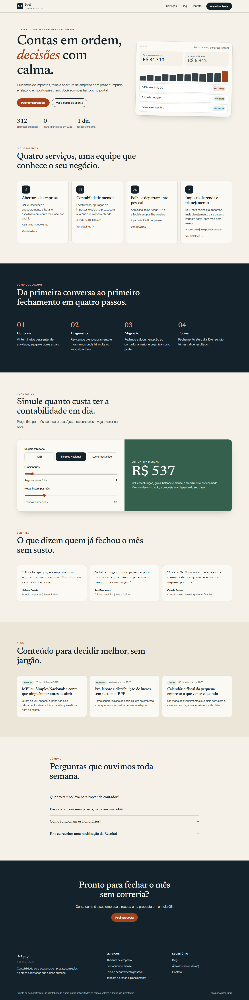
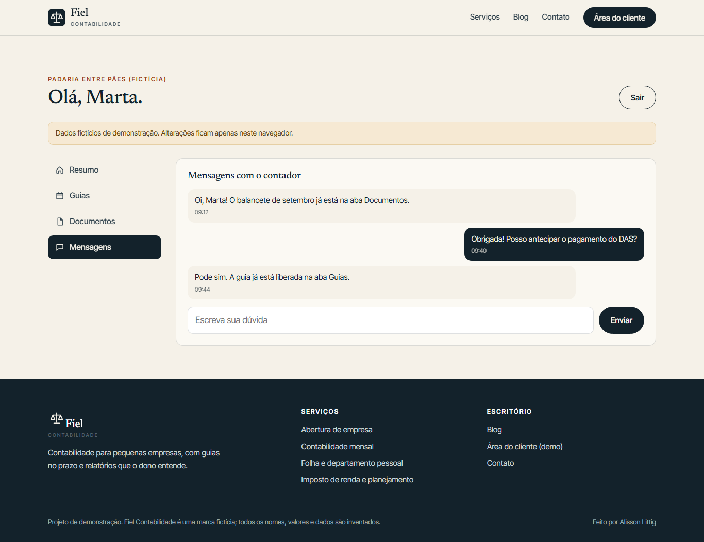
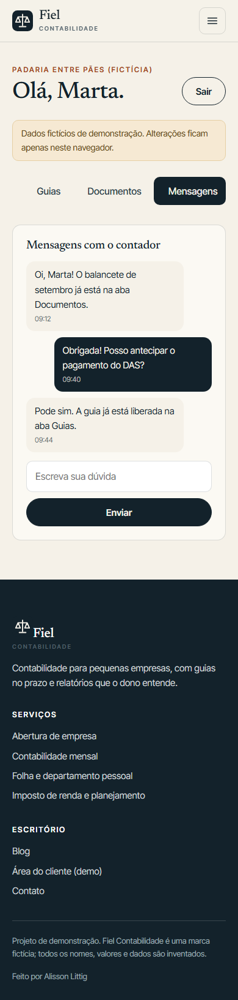

# Fiel Contabilidade

Marketing site and demo client portal for a fictional accounting firm. Built with Next.js (static export), TypeScript and hand-written CSS. All names, figures and company data are invented.

**Live demo:** https://alissonlittig.github.io/fiel-contabilidade/



## What is inside

- **Home** with services, onboarding steps, a fee simulator (regime, headcount, invoice volume), testimonials, blog highlights and FAQ.
- **Services**: index plus four detail pages generated from data (`generateStaticParams`).
- **Blog**: six articles, tag filter, article pages with reading time.
- **Client area (demo)**: login with prefilled demo credentials, dashboard with a 12-month revenue chart, tax payments with due dates moved to the next business day, document list with local "upload", and a message thread. State lives in `localStorage`; nothing is sent anywhere.
- **Contact**: validated form, demo only.

| Client area | Mobile (390 px) |
|---|---|
|  |  |

## Run it

```bash
npm ci
npm test          # Vitest: fee logic, business-day dates, content integrity, validation
npm run build     # static export to ./out
npx serve out
```

For GitHub Pages the workflow builds with `BASE_PATH=/fiel-contabilidade`.

## Notes

- Layout checked at 390 px and 1366 px with no horizontal scroll.
- Fonts are self-hosted via Fontsource (Newsreader, Inter Tight).
- Holidays are not considered when moving due dates to a business day (documented shortcut).

Demo project. Not tax or accounting advice.
